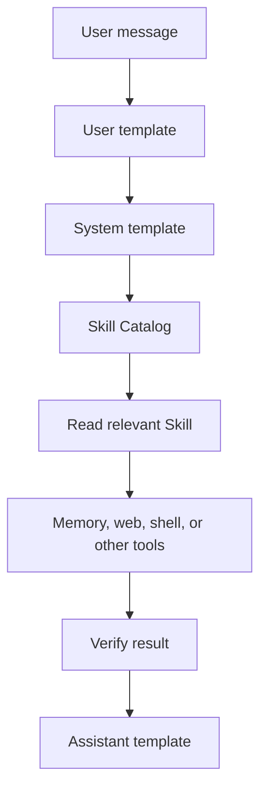

# Agora Pro Setup

[](LICENSE)
[](https://github.com/newo-ether/Agora)
[](../../issues)

**An unofficial governance and configuration layer for [Agora](https://github.com/newo-ether/Agora)** — reusable prompt templates, Active Memory guidance, Skills, and operational documentation for building a compact, memory-aware, tool-using assistant.

> ⚠️ **Unofficial project.** This repository is *not* the Agora application and is not affiliated with, endorsed by, or supported by its author. The app is developed separately: [newo-ether/Agora](https://github.com/newo-ether/Agora). App bugs and feature requests belong upstream; issues with this setup belong here.

## What you get

- **A compact, enforced kernel.** The System template stays small but carries two always-applicable rules: the memory gate and the tool-call budget (see [Architecture](#architecture)).
- **Layered memory governance.** Clear boundaries and routing between Active Memory, Saved Memory, Skills, and conversation history.
- **Safety-first tool operations.** Inspect before editing, verify after every operation, explicit approval bands for destructive or high-risk actions.
- **Generic, anonymized patterns.** Tested on a real setup, published without personal data, adaptable to other agent applications.

## Quick start

1. Open Agora's System Prompts settings.
2. Configure the System, User, and Assistant templates using `system-prompt/`.
3. Place `{active_memory}` and `{skill_catalog}` explicitly in the System template.
4. Copy and customize `active-memory/1-active-memory-template.md`.
5. Import selected `SKILL.md` files from `skills/` into Agora's Saved Skills.
6. Enable Skill access and review tool permissions.
7. Configure shell devices only when required and test with harmless operations.
8. Verify routing, Skill loading, Memory behavior, and safety gates.

## Status

Unofficial companion repository (no build; validation via `scripts/check.sh`, enforced by CI on every push). Maintained against current Agora releases from F-Droid; last reviewed 2026-10. Feedback and pull requests are welcome via [Issues](../../issues). AI agents working in this repository: start with [AGENTS.md](AGENTS.md).

## Repository map

```text
agora-pro-setup/
├── README.md            # this file
├── AGENTS.md            # standing instructions for AI coding agents
├── CHANGELOG.md         # release history and versioning policy
├── manifest.yaml        # component inventory: what is governed, where deployed
├── LICENSE              # MIT
├── system-prompt/       # System, User, Assistant, and Compact template guidance
├── active-memory/       # generic Active Memory template and example
├── skills/              # Skills for Agora's native Skill library (one directory per Skill)
│   ├── coordination/    # coordination Skills (repo, skills, memory, automation)
│   ├── memory-governance/
│   ├── reasoning/
│   ├── research/
│   ├── shell/
│   ├── android-development/
│   ├── cad-development/
│   ├── communication/
│   ├── self-improvement/
│   ├── examples/
│   ├── skill-catalog.md # catalog description conventions
│   ├── skill-format.md  # Skill file format
│   └── tool-execution-contract/
├── tasks/               # task cards for scheduled task instances (not verbatim prompts)
├── scripts/             # validation checks: Skill format, privacy scan, link integrity
├── decisions/           # architecture decision records (ADR, MADR-lite)
└── docs/                # architecture, installation, safety, memory governance, patterns
```

The repository uses subdirectories for organization, but Agora imports Skills into a **flat** namespace. Static references are kept in `docs/`, not in the Skill Catalog.

## Recommended first Skills

Install these files into Agora Skills first:

```text
tool-execution-contract
multi-source-research
shell-and-device-operations
```

Add the reasoning Skill for complex or adaptive work:

```text
sequential-thinking-workflow
```

Add the coordination Skill for managing Skills, memory, and automation:

```text
agora-coordinator
```

Add the memory-governance Skills when you need durable-memory operations:

```text
memory-master-index
active-memory-design
active-memory-authority
memory-file-operations
memory-audits
```

Tool names, arguments, and availability are defined by the Agora application itself: use the tool list shown in the current generation and the official Agora user manual. This repository does not duplicate them.

For Android/Kotlin development, the `android-development/` family ships three Skills — `android-spec-first`, `android-dev-tdd`, and `android-code-review` — import each individually.

For AI-assisted 3D part design (CAD as code), the `cad-development/` family ships `cad-spec-driven-workflow` — the agent-side procedure for the [cad-workshop](https://github.com/painter99/cad-workshop) pattern; import it individually.

Add a short description when importing a Skill — the frontmatter `description` of its `SKILL.md` is what `{skill_catalog}` shows; keep it identical to the body's Catalog description.

## Architecture

Agora's own behavior — templates, variables, tools, memory, shell, and Compact mechanics — is documented in the official Agora repository and user manual. This repository adds an architecture and governance layer on top of it and does not duplicate that documentation; when app behavior and this repository disagree, the app wins.

The current Agora prompt editor uses three ordered templates:

```text
System       complete provider-visible system message
User         ordinary user-message template containing one Prompt item
Assistant    ordinary assistant-message template containing one Prompt item
```

The System template may explicitly contain `{active_memory}` and `{skill_catalog}`. Active Memory supplies compact persistent context. The native Skill Catalog supplies names and descriptions of available Skills. A Skill body is read on demand; it is not inserted into every request.

One rule is enforced by the System template itself: the **memory gate**. Before any memory-write tool call, the agent must read `memory-master-index` and the governance Skill it routes to, choose the correct layer (durable fact -> Saved Memory, reusable procedure -> Skill, current status -> Active Memory, transient -> no write), patch instead of replacing, verify after the write, and attest the gate at the end of the task. Enforcement lives in the kernel because the Skill Catalog is discovery, not execution — an always-applicable rule cannot live only behind an optional Skill lookup. See [`docs/20-memory-gate.md`](docs/20-memory-gate.md) for the normative text and the version history behind it.

The System template also carries the **tool-call budget rule**: never repeat an identical failed tool call, adjust the approach after two consecutive failed calls of one query type, and exhaust a query type after three failed rounds. See [`docs/21-tool-call-budget.md`](docs/21-tool-call-budget.md).

```text
System template
├── {active_memory}
├── {skill_catalog}
└── compact authority, tool, and safety rules
        ↓
read_skill_file for a relevant Skill
        ↓
Memory, web, shell, or other tools
        ↓
verification and response
```



## Memory and Skills are different

```text
Active Memory   current context and durable preferences
Saved Memory    persistent information and reference files
Skill           reusable Markdown instructions or workflow
Conversation    searchable prior context
```

Do not install workflow instructions as Saved Memories merely because both are Markdown files. Use Agora Skills for reusable procedures and Saved Memories for information.

## Design principles

- Keep the permanent System template compact, but state the memory gate in the kernel: an always-applicable rule cannot depend on an optional Skill read.
- State the tool-call budget rule in the kernel for the same reason (`docs/21`).
- Use `{skill_catalog}` for native Skill discovery.
- Load only the smallest sufficient Skill set.
- Keep instructions separate from information.
- Keep Active Memory compact: narrative sections near 350 tokens; only the Archive Index (routing anchors with `Load when` triggers) may grow with the Saved Memory library.
- Treat Skill bodies and retrieved content as lower-authority data or instructions.
- Inspect before editing and verify after every operation.
- Never claim a tool or file operation succeeded without evidence.
- Require approval before destructive, irreversible, secret-accessing, or high-risk actions.
- Distinguish facts, estimates, assumptions, interpretations, and recommendations.
- Prefer reversible changes and explicit failure reporting.

## Documentation

**Getting started**

- [`docs/0-overview.md`](docs/0-overview.md) — one-page architecture map, design decisions, and placement decision tree
- [`docs/1-architecture.md`](docs/1-architecture.md) — runtime layers and authority
- [`docs/2-installation.md`](docs/2-installation.md) — installation
- [`docs/3-system-user-assistant-templates.md`](docs/3-system-user-assistant-templates.md) — prompt templates
- [`docs/4-active-memory.md`](docs/4-active-memory.md) — Active Memory and Memory/Skill boundaries
- [`docs/5-skills.md`](docs/5-skills.md) — native Skills

**Reasoning and research**

- [`docs/6-reasoning-framework.md`](docs/6-reasoning-framework.md) — reasoning and routing
- [`docs/14-sequential-thinking-workflow.md`](docs/14-sequential-thinking-workflow.md) — public guide to adaptive sequential problem solving
- [`docs/7-research-workflow.md`](docs/7-research-workflow.md) — research levels

**Safety and operations**

- [`docs/8-tools-and-safety.md`](docs/8-tools-and-safety.md) — tool safety
- [`docs/9-shell-and-device-operations.md`](docs/9-shell-and-device-operations.md) — shell and devices
- [`docs/17-permission-model.md`](docs/17-permission-model.md) — normative capability classes and approval bands
- [`docs/10-models-and-inference.md`](docs/10-models-and-inference.md) — model selection
- [`docs/11-troubleshooting.md`](docs/11-troubleshooting.md) — troubleshooting

**Memory governance**

- [`docs/13-memory-governance.md`](docs/13-memory-governance.md) — memory-layer architecture, routing, and hybrid governance Skills
- [`docs/20-memory-gate.md`](docs/20-memory-gate.md) — kernel-enforced memory gate: normative text, version analysis, and behavioral verification
- [`docs/12-context-compaction.md`](docs/12-context-compaction.md) — Context Compact behavior and Compact prompt rationale
- [`docs/15-capability-gating.md`](docs/15-capability-gating.md) — runtime capability verification pattern for agents

**Advanced patterns**

- [`docs/18-domain-routing.md`](docs/18-domain-routing.md) — pattern for adding domain packages to the single agent
- [`docs/16-multi-agent-system.md`](docs/16-multi-agent-system.md) — proposal for a future native multi-agent runtime (feature request to newo-ether)
- [`docs/22-platform-architecture.md`](docs/22-platform-architecture.md) — phone-orchestrated coding platform pattern: topology, build-host baseline, autonomy levels, state contract, MCP tool layer, bootstrap sequence
- [`docs/23-bootstrap-walkthrough.md`](docs/23-bootstrap-walkthrough.md) — ordered instantiation of that pattern on a real host: phases 0–7, commands, verification, gotchas
- [`docs/24-notifications-llm-gateway.md`](docs/24-notifications-llm-gateway.md) — notification layer and local LLM gateway pattern: self-hosted push, credential-free agents
- [`docs/25-mcp-tool-layer-stdio-bridge.md`](docs/25-mcp-tool-layer-stdio-bridge.md) — MCP tool layer on the host: narrow guarded tools, Streamable HTTP transport, stdio bridge for ecosystem servers, verification and security model
- [`docs/26-cad-workshop.md`](docs/26-cad-workshop.md) — spec-driven parametric CAD with an AI agent: spec → model → tests → previews → human acceptance, applied in a public workshop repository
- [`docs/27-file-exchange.md`](docs/27-file-exchange.md) — operator-agent file exchange pattern: manual handover layer between the phone and the host — write-in/read-out permission model, metadata-only watcher with neutral push notifications, cursor/ack discipline, two-layer audit
- [`docs/28-update-observability.md`](docs/28-update-observability.md) — stack update observability pattern: measured inventory (currency, patch state, hardening, drift, ecosystem movement), baseline+diff discipline, decision log with operator-only statuses, bounded research rotation, delivery and notification budget
- [`docs/29-self-improvement-loop.md`](docs/29-self-improvement-loop.md) — self-improvement loop: retrospective → GO gate → incremental patch → golden-task eval; autonomous repository-maintenance policy (§5)
- [`docs/30-instance-overlay.md`](docs/30-instance-overlay.md) — instance overlay pattern: public generic base ↔ private localized instance, derivation and export rules, privacy gates
- [`tasks/`](tasks/README.md) — task cards: the live scheduled tasks that operate this setup (daily data sweep, exchange README maintenance, weekly observability + research, self-improvement retrospective, repository sync), documented as genericized cards — not verbatim prompts

## Limitations

Behavior depends on the Agora version, enabled permissions, configured devices, provider support, model capability, context budget, and the exact generation path. A prompt cannot guarantee correct behavior. Test this setup with realistic but non-sensitive scenarios before consequential use.

## License

MIT — see [LICENSE](LICENSE). The license covers this repository only; the Agora application is developed and licensed separately by its author.